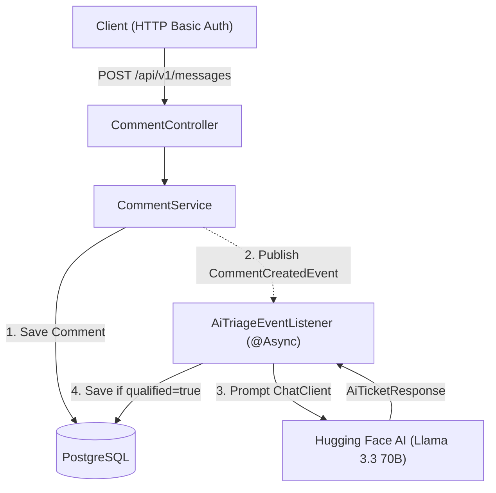

# 📩 Smart Lead Qualification & Comment-to-Ticket Triage API

A production-ready **Spring Boot** REST API that accepts inbound customer messages, secures access with role- and permission-based authentication, and asynchronously analyzes messages using **Spring AI + Hugging Face (Llama 3.3 70B)** to automatically generate prioritized support tickets.

---

## 🧠 Project Overview

**Comment-to-Ticket Triage** automates customer message handling by transforming unstructured user feedback and support inquiries into structured, actionable support tickets.

When an authenticated user submits a message:
1. The comment is persisted immediately to **PostgreSQL** and the API responds with `201 Created`.
2. After the transaction commits, an **asynchronous domain event (`CommentCreatedEvent`)** triggers AI triage in the background.
3. **Spring AI** prompts the `meta-llama/Llama-3.3-70B-Instruct:groq` model via the Hugging Face router to classify whether the message qualifies as a support ticket, and assigns a **title**, **category**, **priority**, and **summary**.
4. Qualified messages are automatically saved as tickets for administrators to review.

---

## 🚀 Example Scenarios

### 🧾 Scenario 1: Billing Issue → High Priority Ticket
**Input (`POST /api/v1/messages`):**
```json
{
  "senderEmail": "john@example.com",
  "content": "I was charged twice for my subscription this month."
}
```
**Async AI Triage Output:**
* **Qualified:** `true`
* **Category:** `BILLING`
* **Priority:** `HIGH`
* **Action:** Support ticket automatically created

---

### 🧾 Scenario 2: Technical Bug → High Priority Ticket
**Input (`POST /api/v1/messages`):**
```json
{
  "senderEmail": "alice@example.com",
  "content": "The app crashes every time I try to upload a file."
}
```
**Async AI Triage Output:**
* **Qualified:** `true`
* **Category:** `BUG`
* **Priority:** `HIGH`
* **Action:** Support ticket automatically created

---

### 🧾 Scenario 3: Non-Qualified Message → No Ticket
**Input (`POST /api/v1/messages`):**
```json
{
  "senderEmail": "mark@example.com",
  "content": "Thanks for your support, everything is working fine!"
}
```
**Async AI Triage Output:**
* **Qualified:** `false`
* **Action:** Message stored only; no ticket created

---

## 🧰 Tech Stack

* **Language:** Java 21
* **Framework:** Spring Boot 4 (Spring Web MVC, Spring Data JPA, Spring Security, Jakarta Validation)
* **AI Integration:** Spring AI (`spring-ai-starter-model-openai`) with Hugging Face Inference Router (`meta-llama/Llama-3.3-70B-Instruct:groq`)
* **Database & Migrations:** PostgreSQL 16, Flyway
* **API Documentation:** Springdoc OpenAPI / Swagger UI
* **Testing:** JUnit 5, Mockito, Spring `WebTestClient`, Testcontainers (PostgreSQL)
* **Build & DevOps:** Maven Wrapper, Docker & Docker Compose, Jib, GitHub Actions CI/CD

---

## 🏗️ Architecture Overview



---

## ⚙️ Key Features

* **Asynchronous AI Triage:** Decouples slow LLM inference calls from the HTTP request lifecycle using `@TransactionalEventListener(phase = AFTER_COMMIT)` and `@Async`.
* **Stateless Security & RBAC:** HTTP Basic authentication with fine-grained role (`USER`, `ADMIN`) and permission authorities (`comment:create`, `own comment:read`, `any comment:read`, `commentList:read`, `ticketList:read`, `tickets:read`).
* **User Ownership Enforcement:** Regular users can only view their own submitted messages, while administrators can query all messages and AI-generated tickets.
* **Brute-Force Login Protection:** Automatically locks an account for **15 minutes** after **5 failed login attempts**, resets the attempt counter upon lock/success, and provides admin unlock endpoints.
* **Database Migrations:** Schema versioned cleanly via Flyway (`V1`–`V3`).
* **Standardized Responses & Error Handling:** Unified `ApiResponse<T>` envelopes and `GlobalExceptionHandler` returning structured `ApiError` payloads without leaking internal stack traces.
* **Environment Profiles:** Separate `local` and `prod` Spring profiles with configurable data seeding.

---

## 📁 Project Structure

```text
comment-to-ticket-triage/
├── .github/workflows/
│   ├── build.yml                  # PR verification pipeline (Maven clean verify)
│   └── deploy.yml                 # Main branch CI/CD (Jib Docker build & EC2 deploy)
├── docker-compose.yml             # Full stack (App + PostgreSQL)
├── docker-compose-db-only.yml     # Local PostgreSQL container (port 5333)
├── Dockerfile
├── pom.xml
└── src/
    ├── main/
    │   ├── java/com/mirkamolcode/
    │   │   ├── config/
    │   │   │   ├── ChatClientConfig.java
    │   │   │   └── DataSeeder.java
    │   │   ├── controller/
    │   │   │   ├── AppUserController.java
    │   │   │   ├── AuthController.java
    │   │   │   ├── CommentController.java
    │   │   │   └── TicketController.java
    │   │   ├── dto/
    │   │   │   ├── AiTicketResponse.java
    │   │   │   ├── ApiResponse.java
    │   │   │   ├── CommentResponse.java
    │   │   │   ├── CreateCommentRequest.java
    │   │   │   ├── RegisterRequest.java
    │   │   │   ├── TicketResponse.java
    │   │   │   └── UserResponse.java
    │   │   ├── entity/
    │   │   │   ├── enums/ (Category, Priority)
    │   │   │   ├── ApplicationUser.java
    │   │   │   ├── Comment.java
    │   │   │   ├── Permission.java
    │   │   │   ├── Role.java
    │   │   │   └── Ticket.java
    │   │   ├── event/
    │   │   │   └── CommentCreatedEvent.java
    │   │   ├── exception/
    │   │   │   ├── ApiError.java
    │   │   │   ├── DuplicateResourceException.java
    │   │   │   ├── GlobalExceptionHandler.java
    │   │   │   └── ResourceNotFoundException.java
    │   │   ├── repository/
    │   │   │   ├── ApplicationUserRepository.java
    │   │   │   ├── CommentRepository.java
    │   │   │   ├── PermissionRepository.java
    │   │   │   ├── RoleRepository.java
    │   │   │   └── TicketRepository.java
    │   │   ├── security/
    │   │   │   ├── LoginAttemptService.java
    │   │   │   └── SecurityConfig.java
    │   │   ├── service/
    │   │   │   ├── AiTriageEventListener.java
    │   │   │   ├── AppUserService.java
    │   │   │   ├── CommentService.java
    │   │   │   ├── HuggingFaceService.java
    │   │   │   ├── JpaUserDetailsService.java
    │   │   │   └── TicketService.java
    │   │   └── CommentToTicketTriageApplication.java
    │   └── resources/
    │       ├── db/migration/
    │       │   ├── V1__Init_Tables.sql
    │       │   ├── V2__Create_Security_Tables_And_Update_Comment.sql
    │       │   └── V3__Add_Locked_Until_To_App_Users.sql
    │       ├── prompt/
    │       │   └── system-lead-prompt.txt
    │       ├── application.yml
    │       ├── application-local.yml
    │       └── application-prod.yml
    └── test/
        └── java/com/mirkamolcode/
            ├── controller/ (CommentIT, TicketIT)
            ├── security/ (LoginAttemptServiceTest)
            ├── service/ (AiTriageEventListenerTest, AppUserServiceTest, CommentServiceTest, HuggingFaceServiceTest, TicketServiceTest)
            ├── AbstractTestConfig.java
            └── SharedPostgresContainer.java
```

---

## 🔐 Authentication & Default Accounts

All endpoints (except `/auth/register` and Swagger UI) require **HTTP Basic Authentication**.

When `app.data-seeder.enabled=true` (enabled by default), the application seeds the following accounts on startup:

| Role | Username | Password | Notes |
| :--- | :--- | :--- | :--- |
| **ADMIN** | `admin123` (or `APP_ADMIN_USERNAME`) | `password` (or `APP_ADMIN_PASSWORD`) | Seeded in all profiles |
| **USER** | `user123` | `password` | Seeded only in non-`prod` profiles |

### Account Lockout Policy
* After **5 consecutive failed login attempts**, the user account is temporarily locked for **15 minutes** and the failed attempt counter is reset to `0`.
* Once the 15-minute window expires, the account automatically unlocks, or an `ADMIN` can unlock it immediately via the `/users/.../unlock` endpoints.

---

## 📡 API Endpoints

**Base URL:** `http://localhost:8080/api/v1`  
**Swagger UI:** `http://localhost:8080/api/v1/swagger-ui/index.html`

### 🔑 Auth (`/auth`)
| Method | Endpoint | Access | Description |
| :--- | :--- | :--- | :--- |
| `POST` | `/auth/register` | Public | Register a new user with the `USER` role (`201 Created`) |

### 💬 Messages (`/messages`)
| Method | Endpoint | Authority Required | Description |
| :--- | :--- | :--- | :--- |
| `POST` | `/messages` | `comment:create` (`USER`, `ADMIN`) | Submit a message and trigger async AI triage (`201 Created`) |
| `GET` | `/messages/my` | `own comment:read` (`USER`, `ADMIN`) | Get paginated messages owned by the authenticated user |
| `GET` | `/messages/{id}` | `own comment:read` (`USER`, `ADMIN`) | Get a specific message owned by the authenticated user |
| `GET` | `/messages` | `commentList:read` (`ADMIN`) | Get paginated list of all messages across all users |
| `GET` | `/messages/all/{id}` | `any comment:read` (`ADMIN`) | Get any message by ID regardless of owner |

### 🎫 Tickets / Leads (`/leads`)
| Method | Endpoint | Authority Required | Description |
| :--- | :--- | :--- | :--- |
| `GET` | `/leads` | `ticketList:read` (`ADMIN`) | List all AI-qualified tickets |
| `GET` | `/leads/{id}` | `tickets:read` (`ADMIN`) | Get a specific ticket by ID |

### 👤 User Administration (`/users`)
| Method | Endpoint | Authority Required | Description |
| :--- | :--- | :--- | :--- |
| `PATCH` | `/users/{id}/unlock` | `ROLE_ADMIN` | Manually unlock a user account by UUID |
| `PATCH` | `/users/username/{username}/unlock` | `ROLE_ADMIN` | Manually unlock a user account by username |

---

## ⚡ Ticket Categories & Priorities

### Categories
| Category | Description |
| :--- | :--- |
| `BUG` | Technical errors, crashes, or broken APIs |
| `FAILURE` | Outages, malfunctioning systems, or broken workflows |
| `BILLING` | Invoices, payments, pricing, or double charges |
| `ACCOUNT` | Login, password, or account access issues |
| `OTHER` | General inquiries that do not fit the categories above |

### Priorities
| Priority | Meaning |
| :--- | :--- |
| `HIGH` | Critical issues, outages, security/access problems, or blockers |
| `MEDIUM` | Significant issues affecting functionality with a workaround |
| `LOW` | Minor issues or general questions with minimal business impact |

---

## ❗ Validation Rules

* **Register (`POST /auth/register`):**
  * `username`: required, 3–50 characters
  * `password`: required, 6–100 characters
* **Create Message (`POST /messages`):**
  * `senderEmail`: required, must be a valid email format
  * `content`: required, must not be blank

---

## ▶️ Running Locally

### Prerequisites
* **Java 21**
* **Docker** (for PostgreSQL and Testcontainers)
* **Hugging Face API Token** with access to Hugging Face Inference Router

### 1. Start the Local PostgreSQL Database
The `local` profile connects to PostgreSQL on port `5333`:
```bash
docker compose -f docker-compose-db-only.yml up -d
```

### 2. Set Environment Variables
Export your Hugging Face token (and optionally custom admin credentials):
```bash
export HUGGINGFACE_API_TOKEN="your_huggingface_token"
export APP_ADMIN_USERNAME="admin123"
export APP_ADMIN_PASSWORD="password"
```

### 3. Run the Application
```bash
# macOS / Linux
./mvnw spring-boot:run

# Windows
mvnw.cmd spring-boot:run
```
Flyway will automatically execute `V1`–`V3` migrations on startup.

### Running the Full Stack via Docker Compose
To run both the application and PostgreSQL in Docker (exposed on `http://localhost:8090/api/v1`):
```bash
HUGGINGFACE_API_TOKEN="your_huggingface_token" docker compose up --build -d
```

---

## 🧪 Running Tests

Integration tests (`*IT`) spin up an isolated PostgreSQL container automatically using **Testcontainers** (ensure Docker Desktop is running).

```bash
# Run unit tests only
./mvnw test

# Run unit + integration tests (Failsafe)
./mvnw clean verify
```
